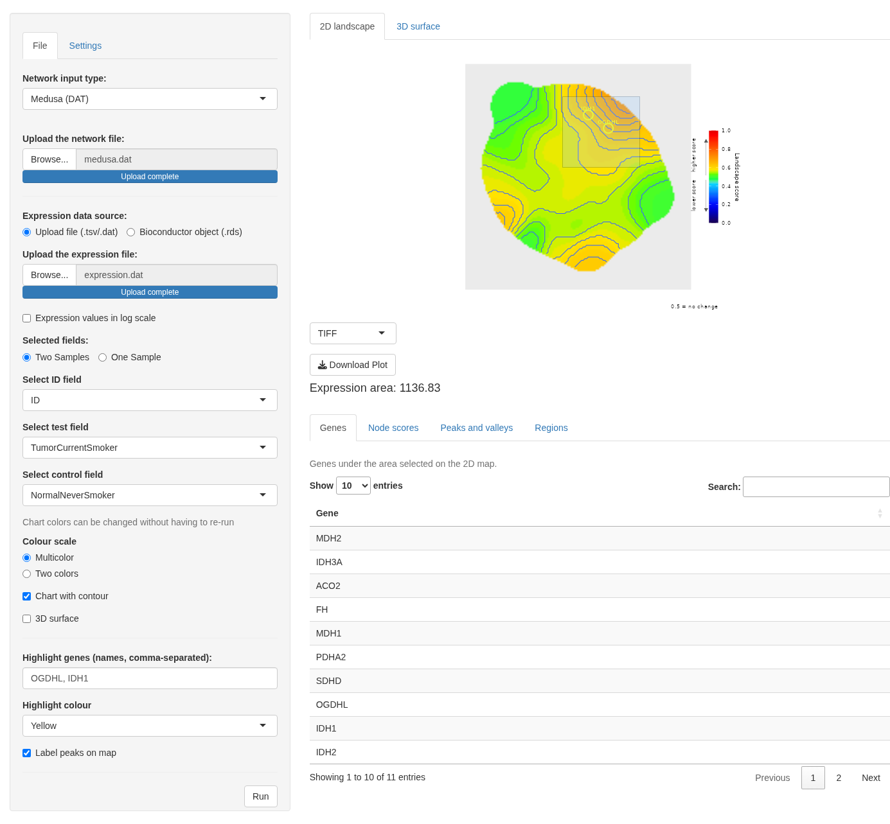
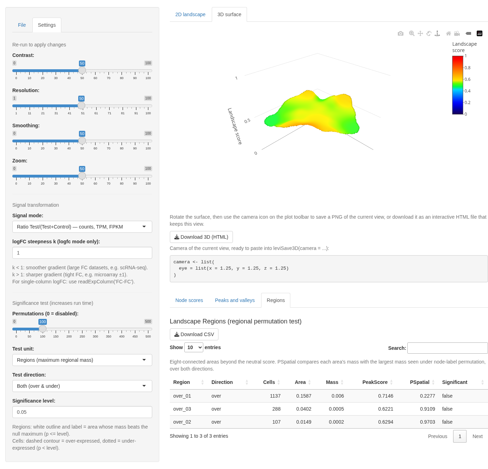

# Overview

The **levi (Landscape Expression Visualization Interface)** package integrates
gene expression data with biological networks. It projects the expression
values onto the plane of the network and computes a continuous surface (the
landscape) by Gaussian smoothing. Elevated regions correspond to genes with a
high transformed signal and to their neighbours in the layout of the network.

**levi** is based on two prior tools: Viacomplex (@Castro2009), written in
Fortran using the Dislin library, and Galant (@Camilo2013), a Cytoscape plugin.

Two files are required to use **levi**: a gene expression file and a biological
network file. Alternatively, results from differential expression tools
(DESeq2, edgeR, limma) or single-cell tools (Seurat) can be passed directly
as R objects.

**Web interface (no installation required):** An interactive demo is available
via Binder at:
`https://mybinder.org/v2/gh/jrybarczyk/levi/master?urlpath=shiny/inst/shiny/`

# Input Files

## Gene Expression Data

The expression file must contain a column with gene identifiers (Gene Symbol,
Entrez ID, Ensembl, etc.) and at least one column with expression values
(e.g., normalized counts, log2 fold-change).

If some network genes have no expression value, **levi** assigns the neutral
value 0.5, which represents no change. The missing genes are listed in
`result$metadata$missing_genes` and in a log file, `levi.log`, written to a
subdirectory of the temporary directory of the R session (`tempdir()`) that is
named after the comparison.

Expression data can be obtained from:

* [Gene Expression Omnibus (GEO)](https://www.ncbi.nlm.nih.gov/geo/)
* [Array Express](https://www.ebi.ac.uk/arrayexpress/)
* [The Cancer Genome Atlas (TCGA)](https://cancergenome.nih.gov/)
* [Sequence Read Archive (SRA)](https://www.ncbi.nlm.nih.gov/sra)

## Biological Network

**levi** supports the following network file formats:

|Extension|Format|
|:-------:|:----:|
|`dat`|Medusa (DAT) [@Hooper2005]|
|`dyn`|RedeR (DYN) [@Castro2012]|
|`net`|Pajek (NET) [@Batagelj1998]|
|`stg`|STRING / STITCH [@Szklarczyk2021]|

Network interaction data can be obtained from:

* [STRING database](https://string-db.org/)
* [miRBase](https://mirbase.org/)

## Networks with no coordinates

Every format above carries a position for each node, because **levi** computes
the landscape over the plane that the network occupies. Interaction databases
usually provide a list of interacting pairs without coordinates.

`leviFromEdges()` computes the coordinates with **igraph** [@Csardi2006] and
returns the two tables that `levi()` requires:

```{r eval=TRUE, fig.height=5, fig.width=5}
library(levi)

interactions <- data.frame(
    from = c("HUB", "HUB", "HUB", "HUB", "N1", "N2", "N3", "N4"),
    to   = c("N1", "N2", "N3", "N4", "N5", "N6", "N7", "N8"),
    stringsAsFactors = FALSE)

set.seed(42)                       # force-directed layouts are stochastic
net <- leviFromEdges(interactions, layout = "kk")
head(net$nodes)

expression <- data.frame(
    ID      = c("HUB", paste0("N", 1:8)),
    Test    = c(200, 200, 200, 200, 200, 5, 5, 5, 5),
    Control = c(10, 10, 10, 10, 10, 200, 200, 200, 200))

res_edges <- levi(
    networkCoordinatesInput  = net$nodes,
    networkInteractionsInput = net$edges,
    fileTypeInput            = "stg",
    expressionInput          = expression,
    geneSymbolInput          = "ID",
    readExpColumn            = readExpColumn("Test-Control"),
    resolutionValueInput     = 30,
    smoothValueInput         = 50)

res_edges$scores[, c("Gene", "LandscapeScore", "Rank")]
```

The layout is an analytical choice and not only a graphical one. The same
expression values on a different layout give a different landscape, because
**levi** evaluates neighbourhoods in the layout plane, and the layout is part
of every landscape test. Where a curated layout exists, it is preferable to a
computed one.

# Viewing Modes

## Graphical User Interface (GUI)

The GUI runs locally via Shiny. It calls `levi()` with the parameters chosen
in the side panel and runs the node-label analysis and the landscape display.
The sample-label tests, blocks, exact enumeration, the graph tests,
`leviEnrich()` and `leviSave3D()` are available in script mode only. The
node-label results of the interface agree with those of script mode under the
same seed.

```{r eval=FALSE}
library(levi)
LEVIui(browser = TRUE)   # Opens in the system browser
LEVIui(browser = FALSE)  # Opens inside RStudio
```

<center></center>
<center><b>Figure 1:</b> The interface after a run on the example data, with
the <i>File</i> tab of the side panel, the 2D landscape and the genes under
the area selected on the map.</center>

### Side panel

The side panel has two tabs. **File** holds everything needed for a run;
**Settings** holds the parameters that change the landscape and the test.

*File tab*

* **Network input type** and **Upload the network file**: the network format
  (Medusa DAT, RedeR DYN, Pajek NET or STRING/STITCH) and the file itself. The
  STRING/STITCH option asks for two files, coordinates and interactions.
* **Expression data source**: a tab-delimited file, or a Bioconductor object
  saved as `.rds` (`SummarizedExperiment`, `SingleCellExperiment` or
  `ExpressionSet`). For a file, tick **Expression values in log scale** when
  the columns are log2 values and choose **Two Samples** (test against
  control) or **One Sample**. For an object, choose the assay, the condition
  column and the test and control levels.
* **Select ID field**, **Select test field**, **Select control field**: the
  column with the gene identifiers, which must match the node names of the
  network, and the two columns to compare.
* **Colour scale**: *Multicolor*, or *Two colors* with one of six palettes.
  Colours are applied without re-running.
* **Chart with contour** adds contour lines to the map. **3D surface** builds
  the interactive surface and brings the *3D surface* tab to the front.
* **Highlight genes** draws a circle, in the chosen colour, at the grid cell
  of each gene listed. **Label peaks on map** writes the name of the gene
  closest to each detected peak and valley.
* **Run** builds the landscape.

*Settings tab*

* **Contrast**, **Resolution**, **Smoothing** and **Zoom**: the visual
  parameters of `levi()`. Contrast sets the occupancy threshold of the
  silhouette (higher values give a tighter silhouette), resolution the grid
  size, smoothing the width of the Gaussian kernel relative to the grid, and
  zoom the frame around the network (0 is the widest frame, 100 the
  tightest). Their ranges and effects are tabulated in
  `vignette("levi_guide")`.
* **Signal mode** and **logFC steepness k**: the conversion of expression
  values into the landscape score, see *Signal transformation*.
* **Permutations**, **Test unit**, **Test direction** and **Significance
  level**: the node-label permutation test. With permutations above zero the
  significant regions are outlined and labelled on the map; the default test
  unit is the region (maximum regional mass), the legacy per-cell test is
  still offered.

### Results

The main panel shows the figure in two tabs and the tables in four.

* **2D landscape**: the map, with a format selector (TIFF, BMP, JPEG, PNG)
  and **Download Plot**. Click and drag on the map to select an area:
  **Expression area** shows the summed score of the selected cells and the
  **Genes** tab lists the genes under the selection.
* **3D surface**: the interactive surface, shown when *3D surface* is ticked.
  Rotate it, then use the camera icon of the toolbar to save a PNG of the
  current view, or **Download 3D (HTML)** to keep the view in an interactive
  file. The camera of the current view is printed as R code that can be passed
  to `leviSave3D(camera = ...)` to reproduce the view in script mode.
* **Genes**: the genes under the area selected on the 2D map. This tab is
  shown only while the 2D map is in front.
* **Node scores**: the landscape score of every node, ranked, with a CSV
  download. This is `result$scores` of script mode.
* **Peaks and valleys**: the detected extrema and the closest gene to each.
  This is `result$peaks`.
* **Regions**: the connected areas of the landscape beyond the neutral score,
  with their size, mass and peak score; after a permutation test, the
  regional p-value and whether the region passes the significance level.
  This is `result$regions$summary`.

<center></center>
<center><b>Figure 2:</b> The <i>Settings</i> tab of the side panel, the 3D
surface and the regions table after a permutation test with 100
iterations.</center>

A busy indicator is shown at the top of the page while the landscape or the
permutation test is computed.

## Script Mode

### Basic usage

```{r eval=TRUE, fig.height=6, fig.width=6}
library(levi)

template_network <- file.path(system.file(package = "levi"), "extdata",
                              "medusa.dat", fsep = .Platform$file.sep)

template_expression <- file.path(system.file(package = "levi"), "extdata",
                                 "expression.dat", fsep = .Platform$file.sep)

multicolor <- levi(
    networkCoordinatesInput = template_network,
    expressionInput        = template_expression,
    fileTypeInput          = "dat",
    geneSymbolInput        = "ID",
    readExpColumn          = readExpColumn("TumorCurrentSmoker-NormalNeverSmoker"),
    contrastValueInput     = 50,
    resolutionValueInput   = 20,
    zoomValueInput         = 50,
    smoothValueInput       = 5,
    contourLevi            = TRUE
)
```

The example dataset contains lung adenocarcinoma microarray data
[@Landi2008] comparing tumor tissue from current smokers against normal
tissue from never-smokers.
Elevated regions (warm colours) correspond to network areas in which the
transformed signal is higher in tumours, and depressed regions (cool colours)
to areas in which it is lower. The contour lines mark the boundaries between
score levels.

### Comparing multiple conditions (batch mode)

The `readExpColumn()` function allows several comparisons to be processed in
one call:

```{r eval=TRUE, fig.height=6, fig.width=6}
base <- readExpColumn(
    "TumorCurrentSmoker-NormalNeverSmoker",
    "TumorFormerSmoker-NormalFormerSmoker"
)

levi(
    networkCoordinatesInput = template_network,
    expressionInput         = template_expression,
    fileTypeInput           = "dat",
    geneSymbolInput         = "ID",
    readExpColumn           = base,
    setcolor                = "pink_green",
    contourLevi             = FALSE
)
```

### Signal transformation (`signal_mode`)

The `signal_mode` parameter controls how raw expression values are converted
to the landscape score in \[0, 1\]. The choice depends on the data type:

| `signal_mode` | Formula | Score 0.5 means | Best for |
|:---:|:---|:---|:---|
| `"ratio"` (default) | `Test / (Test + Control)` | Test ≈ Control | Raw counts, TPM, FPKM, linear proteomics LFQ |
| `"logfc"` | `1 / (1 + e^{−k · logFC})` | logFC = 0 (no change) | RMA microarray, VST/rlog DESeq2, log2-proteomics, scRNA-seq avg\_log2FC |
| `"zscore"` | `pnorm(z)` where `z = (logFC − μ) / σ` | Mean logFC of support points | Relative position within a comparison |

**Quick guide by experiment type:**

| Data type | `signal_mode` | `expressionLog` | Input columns |
|:---|:---:|:---:|:---|
| Raw counts (RNA-seq) | `"ratio"` | `FALSE` | mean\_test, mean\_ctrl |
| TPM / FPKM | `"ratio"` | `FALSE` | mean\_test, mean\_ctrl |
| Microarray RMA (log2) | `"logfc"` | `FALSE` | log2\_test, log2\_ctrl |
| DESeq2 `log2FoldChange` only | `"logfc"` | `FALSE` | `readExpColumn("log2FoldChange-log2FoldChange")` |
| edgeR / limma `logFC` only | `"logfc"` | `FALSE` | `readExpColumn("logFC-logFC")` |
| scRNA-seq `avg_log2FC` | `"logfc"` + `logfc_k = 0.5` | `FALSE` | `readExpColumn("avg_log2FC-avg_log2FC")` |
| scRNA-seq `pct.1` / `pct.2` | `"ratio"` | `FALSE` | pct.1, pct.2 |
| Proteomics log2 LFQ | `"logfc"` | `FALSE` | log2\_LFQ\_test, log2\_LFQ\_ctrl |
| Multi-condition / heterogeneous | `"zscore"` | any | Test, Control |

The `logfc_k` parameter controls the steepness of the sigmoid in `"logfc"` mode.
The ranges below are rules of thumb. The package default is `k = 1`, and the
analyses of the accompanying manuscript used `k = 0.7` for all datasets.

- **`k = 0.3–0.5`** — large fold-change datasets (scRNA-seq often reaches ±5)
- **`k = 1`** (default) — typical RNA-seq or proteomics (±2)
- **`k = 2–3`** — tight microarray fold-changes (±0.5–1)

```{r eval=FALSE}
# Microarray RMA — keep log2 scale, use logfc mode
res_rma <- levi(
    networkCoordinatesInput = template_network,
    expressionInput         = rma_expression_df,   # columns: ID, Tumor_log2, Normal_log2
    fileTypeInput           = "dat",
    geneSymbolInput         = "ID",
    readExpColumn           = readExpColumn("Tumor_log2-Normal_log2"),
    signal_mode             = "logfc",
    expressionLog           = FALSE   # keep in log2 scale; no 2^ transform
)

# scRNA-seq — single-column avg_log2FC with reduced steepness
res_sc <- levi(
    networkCoordinatesInput = template_network,
    expressionInput         = seurat_markers_df,  # column: GeneID, avg_log2FC
    fileTypeInput           = "dat",
    geneSymbolInput         = "GeneID",
    readExpColumn           = readExpColumn("avg_log2FC-avg_log2FC"),
    signal_mode             = "logfc",
    logfc_k                 = 0.5     # softer gradient for large FC values
)

# DESeq2 log2FoldChange as single column
res_deseq <- levi(
    networkCoordinatesInput = template_network,
    expressionInput         = leviFromDESeq2(dds_result),
    fileTypeInput           = "dat",
    geneSymbolInput         = "GeneID",
    readExpColumn           = readExpColumn("log2FoldChange-log2FoldChange"),
    signal_mode             = "logfc"
)
```

The recipes above refer to objects of the analyst's own analysis. The package
ships a small log2-scale dataset, so that the `"logfc"` recipe can be run as
written:

```{r eval=TRUE, fig.height=5, fig.width=5}
logfc_net  <- system.file("extdata", "logfc_network.dat", package = "levi")
logfc_expr <- system.file("extdata", "logfc_expression.dat", package = "levi")

# Control is 8 for every gene and Test runs from 3 to 10, so the logFC
# spans -5 to +2 on the log2 scale.
res_logfc <- levi(
    networkCoordinatesInput = logfc_net,
    expressionInput         = logfc_expr,
    fileTypeInput           = "dat",
    geneSymbolInput         = "ID",
    readExpColumn           = readExpColumn("Test-Control"),
    resolutionValueInput    = 40,
    signal_mode             = "logfc",
    expressionLog           = FALSE   # already log2; no back-transform
)

res_logfc$scores[, c("Gene", "LandscapeScore", "Rank")]
```

Only `GF` has a score above the neutral value 0.5; it is the single gene whose
test value exceeds the control.

### Two-color palettes

The `setcolor` parameter selects the color palette. Available options are:

| Value | Description |
|:---:|:---|
|`"default"`| 20-level multicolor (blue → red)|
|`"purple_pink"`| Two-color: purple → pink|
|`"green_blue"`| Two-color: green → blue|
|`"blue_yellow"`| Two-color: blue → yellow|
|`"pink_green"`| Two-color: pink → green|
|`"orange_purple"`| Two-color: orange → purple|
|`"green_marine"`| Two-color: green → marine|

# 3D Interactive Visualization

When the `plotly` package is installed, **levi** can generate an interactive
3D surface plot in addition to the standard 2D landscape. The surface can be
rotated and zoomed, and the values can be inspected interactively.

```{r eval=FALSE}
install.packages("plotly")

levi(
    networkCoordinatesInput = template_network,
    expressionInput         = template_expression,
    fileTypeInput           = "dat",
    geneSymbolInput         = "ID",
    readExpColumn           = readExpColumn("TumorCurrentSmoker-NormalNeverSmoker"),
    plot3d                  = TRUE
)
```

The 3D surface uses the same colour palette as the 2D plot. Peaks of the
landscape correspond to network sub-regions with a high transformed signal in
the test condition, and valleys to sub-regions with a low transformed signal.

# Importing from Differential Expression Tools

**levi** accepts results directly from standard differential expression
workflows: DESeq2 [@Love2014], edgeR [@Robinson2010], limma [@Ritchie2015]
and Seurat [@Hao2021]. This avoids the manual preparation of input files.

## From DESeq2

```{r eval=FALSE}
library(DESeq2)
library(levi)

# After running DESeq2 analysis:
res <- results(dds, contrast = c("condition", "Tumor", "Normal"))

expr_df <- leviFromDESeq2(res, gene_col = "GeneSymbol")

levi(
    expressionInput         = expr_df,
    networkCoordinatesInput = template_network,
    fileTypeInput           = "dat",
    geneSymbolInput         = "GeneSymbol",
    readExpColumn           = readExpColumn("log2FoldChange-log2FoldChange"),
    signal_mode             = "logfc"
)
```

## From edgeR

```{r eval=FALSE}
library(edgeR)
library(levi)

fit  <- glmQLFit(dge, design)
qlf  <- glmQLFTest(fit, coef = 2)

expr_df <- leviFromEdgeR(qlf, gene_col = "GeneSymbol")

levi(
    expressionInput         = expr_df,
    networkCoordinatesInput = template_network,
    fileTypeInput           = "dat",
    geneSymbolInput         = "GeneSymbol",
    readExpColumn           = readExpColumn("logFC-logFC"),
    signal_mode             = "logfc"
)
```

## From limma

```{r eval=FALSE}
library(limma)
library(levi)

fit2    <- eBayes(fit)
expr_df <- leviFromLimma(fit2, coef = "TvsC", gene_col = "GeneSymbol")

levi(
    expressionInput         = expr_df,
    networkCoordinatesInput = template_network,
    fileTypeInput           = "dat",
    geneSymbolInput         = "GeneSymbol",
    readExpColumn           = readExpColumn("logFC-logFC"),
    signal_mode             = "logfc"
)
```

## Checking the adapters without the tools

Each adapter also accepts a plain `data.frame` with the columns that the
corresponding tool produces. The conversion can therefore be reproduced
without the tools, and a pipeline can be tested before the full set of
packages is installed:

```{r eval=TRUE}
# A DESeq2 results table has baseMean and log2FoldChange.
res_de <- data.frame(
    baseMean       = c(1200, 1100, 900),
    log2FoldChange = c(4.3, 4.1, -5.3),
    row.names      = c("HUB", "N1", "N5"))
leviFromDESeq2(res_de, gene_col = "GeneID")

# An edgeR topTags table has logFC and logCPM.
tt_edger <- data.frame(
    logFC     = c(4.3, -5.1),
    logCPM    = c(10.2, 9.8),
    row.names = c("HUB", "N5"))
leviFromEdgeR(tt_edger, gene_col = "GeneID")

# A limma topTable has logFC and AveExpr.
tt_limma <- data.frame(
    logFC     = c(4.3, -5.1),
    AveExpr   = c(8.1, 7.7),
    row.names = c("HUB", "N5"))
leviFromLimma(tt_limma, gene_col = "GeneID")

# A Seurat FindMarkers table has avg_log2FC and pct.2, which become
# Test and Control.
mk_seurat <- data.frame(
    avg_log2FC = c(2.5, -1.8),
    pct.2      = c(0.3, 0.8),
    row.names  = c("HUB", "N5"))
leviFromSeurat(mk_seurat, gene_col = "GeneID")
```

# Quantitative Analysis of the Landscape

## Node landscape scores

Every `levi()` call returns a ranked table of landscape scores invisibly.
A score close to 1 indicates a high transformed signal in the neighbourhood of
the gene in the layout; a score close to 0 indicates a low transformed signal.

**The network weights the landscape by degree.** With the default
`edge_weighting = "midpoint"`, each edge adds a support point at its midpoint,
which carries the mean signal of its two endpoints. Every node and every
midpoint has weight one. A hub with twenty interactions is therefore
surrounded by twenty midpoints, whereas a leaf adds one. The smoothed surface
around a hub is dominated by the hub and its neighbours, and a moderately
changed hub can appear more prominent than a strongly changed peripheral
gene. The permutation tests keep the network fixed, so the weighting is part
of their null and does not bias the p-values. It affects the emphasis of the
figure, and `result$scores` is to be read together with the degree of the
node.

The argument `edge_weighting` selects the weighting of the midpoints:

* `"midpoint"` (default): one support point of weight one per edge midpoint.
  The landscape is weighted implicitly by degree.
* `"degree"`: the midpoint of the edge between nodes i and j has the weight
  (1/d~i~ + 1/d~j~)/2, where d is the degree. Each node of degree at least one
  contributes a total weight of 1/2 to its incident midpoints. The weights of
  the midpoints incident on one node sum to one in degree-regular graphs and
  not in general. The node itself keeps the weight one.
* `"none"`: the midpoints are omitted and the node values alone are smoothed.

All three options use the same coordinates, silhouette and permutation nulls.
The choice is stored in `result$metadata$edge_weighting` and is reused by the
sample-label tests. The scores of the example network under the three
options, for the eight highest scores of the default option, and the Spearman
correlation of the scores between the options, are:

```{r edge_weighting, fig.show="hide"}
ew_scores <- sapply(c("midpoint", "degree", "none"), function(w) {
    r <- levi(networkCoordinatesInput = template_network,
              expressionInput         = template_expression,
              fileTypeInput           = "dat",
              geneSymbolInput         = "ID",
              readExpColumn           = readExpColumn("TumorCurrentSmoker-NormalNeverSmoker"),
              resolutionValueInput    = 20,
              smoothValueInput        = 5,
              edge_weighting          = w)
    s <- r$scores
    setNames(s$LandscapeScore, s$Gene)[sort(s$Gene)]
})
round(head(ew_scores[order(-ew_scores[, "midpoint"]), ], 8), 3)
round(cor(ew_scores, method = "spearman"), 2)
```

```{r eval=TRUE, fig.height=6, fig.width=6}
result <- levi(
    networkCoordinatesInput = template_network,
    expressionInput         = template_expression,
    fileTypeInput           = "dat",
    geneSymbolInput         = "ID",
    readExpColumn           = readExpColumn("TumorCurrentSmoker-NormalNeverSmoker"),
    contrastValueInput      = 50,
    resolutionValueInput    = 20,
    zoomValueInput          = 50,
    smoothValueInput        = 5
)

# Top 10 most altered genes in the network
head(result$scores, 10)
```

The `scores` table contains columns `Gene`, `X`, `Y`, `LandscapeScore`
(0–1), and `Rank`. The scores are descriptive; the values 0.7 and 0.3 are not
thresholds of a test. Significance is assessed with the permutation tests
below.

## Automatic peak detection

Peaks (local maxima) and valleys (local minima) are detected automatically
and returned in `result$peaks`. Each row reports the nearest gene,
the matrix position, and the landscape score.

```{r eval=TRUE}
# Detected peaks (up-regulated regions) and valleys (down-regulated)
result$peaks
```

## Permutation significance test

The argument `n_perm` runs a permutation test of the regions of the landscape.
The measured expression values are shuffled among the network nodes, the edge
signals are recalculated and the landscape is rebuilt in every permutation.
The layout is not changed.

By default (`inference_unit = "region"`) the eight-connected regions beyond
the neutral score are redetected in every permutation and each observed
region is compared with the largest regional mass seen under the null
[@Westfall1993; @Nichols2002], over
both directions. `result$regions$summary` gains `PSpatial` and
`Significant`, and significant regions are outlined in white on the plot.
The legacy `inference_unit = "cell"` tests every grid cell and draws
contours from BY-adjusted p-values; it is what the graphical interface uses.
The vignette `levi_inference` explains which null answers which question.

```{r eval=TRUE, fig.height=6, fig.width=6}
result_sig <- levi(
    networkCoordinatesInput = template_network,
    expressionInput         = template_expression,
    fileTypeInput           = "dat",
    geneSymbolInput         = "ID",
    readExpColumn           = readExpColumn("TumorCurrentSmoker-NormalNeverSmoker"),
    n_perm    = 100,     # larger values improve the p-value resolution
    sig_level = 0.05,
    perm_side = "both"   # "over", "under", or "both" (default)
)

# One row per region, with its permutation p-value:
result_sig$regions$summary[, c("Region", "Direction", "Cells", "Mass",
                               "PSpatial", "Significant")]
```

With `inference_unit = "cell"`, `result$pvalues` holds the `$over` and
`$under` adjusted p-value matrices instead, and the landscape overlays two
contours:

| Contour | Line style | Meaning |
|---------|-----------|---------|
| **Dashed** (white) | `perm_side = "over"` | Significantly **over**-expressed region (p_over < 0.05) |
| **Dotted** (white) | `perm_side = "under"` | Significantly **under**-expressed region (p_under < 0.05) |

Use `perm_side = "both"` (default) to show both simultaneously.

**Interpretation:** a region or contour marks an area of the landscape whose
mass exceeds the null distribution obtained by shuffling the values among the
nodes of the fixed network and layout. The null conditions on the network
topology and on the layout; it does not control for them. The result is a
statement about the spatial organisation of the values on this network and
layout. It is not evidence of replication, and it is not a test of individual
genes.

## Beyond the landscape test: replication and graph TFCE

The node-label p-value above is conditional on the network and on its layout.
It tests whether the observed arrangement of the values is more clustered
than arrangements of the same values on the same layout. It does not address
replication, and the layout is part of the test: a different layout of the
same graph defines a different test. Two consequences follow.

* **Networks in which most genes respond.** The statistic is area-weighted.
  When most of a network responds (for example an a-priori pathway under a
  stimulus that affects most of its genes), shuffled arrangements produce
  regions of similar mass. In the analyses of the accompanying manuscript the
  node-label p-value was 0.21 to 0.89 on the Kang monocyte networks of this
  type, and it can fall below 0.05 under neighbouring parameter settings (on
  the macrophage Toll-like network it was below 0.05 in 10 of 27 settings of
  the threshold, the smoothing and `logfc_k`). The test addresses a spatial
  question and not the existence of an effect.
* **Dependence on the layout.** Force-directed layouts are stochastic, and the
  regions detected on one layout overlap only partly with those detected on
  another (`vignette("levi_validation")`).

When biological replicates are available, the landscape can be reported
together with two sample-label tests, which permute the condition labels
across replicates instead of the values across nodes:

* `leviReplicateInference()` keeps the landscape and its regions but recomputes
  the fold-change from permuted labels, so `PSpatial` now answers whether the
  region replicates.
* `leviGraphTFCEInference()` needs no layout at all. It fits a limma
  moderated t per gene [@Smyth2004] and integrates it over every threshold
  with threshold-free cluster enhancement [@Smith2009] on the network
  components, controlling
  the family-wise error rate with the maximum over genes and directions. It
  does not depend on the layout. Against a module concentrated around a hub, in
  the simulations reported in `vignette("levi_validation")`, its power was
  greater than or equal to that of the sample-label regional test at every
  effect size.

**Validity condition.** A sample-label test, or a graph test, is a replication
test only when the network and its gene set are fixed independently of the
labels that are permuted. When the genes were selected on the same samples
(for example the top differentially expressed genes of the tested contrast)
and held fixed during the permutations, the observed statistic has been
maximised over the gene universe. In the simulation of the manuscript this
procedure rejected under the global null in 85 to 87 % of the datasets with
4 vs 4 samples (exact enumeration) and in 99 to 100 % with 8 vs 8 samples
(Monte Carlo, 199 draws), whereas re-selecting the genes inside each
permutation or selecting them on separate samples gave 0.015 to 0.060.
Results on a network built from genes selected on the tested samples are
descriptive. The valid designs (a network fixed a priori, closed-loop
selection and split-sample selection) are described in `vignette("levi_inference")`.

With four replicates per group the example below is small enough to enumerate
all `choose(8, 4) = 70` label arrangements. The complement of an arrangement
gives the same maximum over both directions and ties the observed value, so
the smallest attainable p-value is 2/70 = 0.029.

```{r replication_tfce, eval=TRUE}
hub_net <- system.file("extdata", "hub_network.dat", package = "levi")
genes   <- c("HUB", paste0("N", 1:8))

# Four control and four treated replicates on a log2 scale; the hub and its
# first two neighbours respond.
set.seed(2026)
expression <- matrix(rnorm(9 * 8, mean = 6, sd = 0.3), 9, 8,
                     dimnames = list(genes, paste0("s", 1:8)))
groups <- rep(c("control", "treated"), each = 4)
expression[c("HUB", "N1", "N2"), groups == "treated"] <-
    expression[c("HUB", "N1", "N2"), groups == "treated"] + 1.5

# Landscape regions tested against biological replication
rep_res <- leviReplicateInference(
    expression, groups, test = "treated", control = "control",
    networkCoordinatesInput = hub_net, fileTypeInput = "dat",
    resolutionValueInput = 20, smoothValueInput = 30, seed = 1)
rep_res$regions$summary[, c("Region", "Direction", "Mass", "PSpatial",
                            "Significant")]

# Layout-free confirmation: graph TFCE with the same null
tfce <- leviGraphTFCEInference(
    expression, groups, hub_net, test = "treated", control = "control",
    seed = 1)
tfce$statistic[order(tfce$statistic$PGlobal), ][1:4, ]
```

In this simulated example the hub and its two neighbours respond by
construction, and the network is fixed independently of the labels. The
node-label test alone does not address whether such a response replicates. For
paired designs the argument `blocks` is used, and for single-cell data the
`leviSingleCell*` functions, which permute donors and not cells. The vignette
`levi_inference` describes the three nulls and the attainable p-values of
small designs, and `levi_validation` reports their calibration and power.

# Single-Cell RNA-seq (Seurat)

**levi** can display the marker genes of a single-cell analysis from Seurat
[@Hao2021] on a biological network. Marker tables describe cells; tests that
treat donors, and not cells, as replicates are provided by the
`leviSingleCell*` functions (`vignette("levi_inference")`).

```{r eval=FALSE}
library(Seurat)
library(levi)

# Find markers for a specific cell cluster:
markers <- FindMarkers(seurat_obj,
                       ident.1 = "TumorCluster",
                       ident.2 = "NormalCluster")

expr_df <- leviFromSeurat(markers, gene_col = "GeneSymbol")

levi(
    expressionInput         = expr_df,
    networkCoordinatesInput = template_network,
    fileTypeInput           = "dat",
    geneSymbolInput         = "GeneSymbol",
    readExpColumn           = readExpColumn("Test-Control"),
    expressionLog           = TRUE,
    plot3d                  = TRUE
)
```

# Toy datasets for testing and validation

**levi** ships several small toy datasets in `inst/extdata/` with known expected
results. Each dataset is designed to test one feature independently.

## Available datasets

| Dataset pair | Topology | What it tests |
|:---|:---|:---|
| `hub_network` + `hub_expression` | Star (9 nodes) | Score highest at hub; Gaussian smoothing propagation |
| `gradient_network` + `gradient_expression` | Linear chain (6 nodes) | Strict monotone ordering of scores |
| `bimodal_network` + `bimodal_expression` | Two stars + bridge (13 nodes) | Simultaneous peak + valley; `leviDiff` |
| `flat_network` + `flat_expression` | 3×3 grid (9 nodes) | No false-positive peaks; uniform expression |
| `logfc_network` + `logfc_expression` | Linear chain, log2 intensities | `signal_mode = "logfc"` contrast improvement |
| `hub_multicomp_expression` | Reuses hub network | Batch mode; `leviGrid`; `leviDiff` |
| `sparse_network` + `sparse_expression` | Chain (15 nodes, 5 expressed) | NA handling; missing gene neutrality |

## Bimodal dataset

Two hubs (over-expressed cluster A and under-expressed cluster B) connected by
a neutral bridge gene. The expected landscape has a peak on the left and a
valley on the right; the dataset is used to test `leviDiff`.

```{r eval=TRUE, fig.height=5, fig.width=7}
bimodal_net  <- file.path(system.file(package="levi"), "extdata",
                           "bimodal_network.dat")
bimodal_expr <- file.path(system.file(package="levi"), "extdata",
                           "bimodal_expression.dat")

res_bimodal <- levi(
    networkCoordinatesInput = bimodal_net,
    expressionInput         = bimodal_expr,
    fileTypeInput           = "dat",
    geneSymbolInput         = "ID",
    readExpColumn           = readExpColumn("Test-Control"),
    contrastValueInput      = 50,
    resolutionValueInput    = 20,
    zoomValueInput          = 50,
    smoothValueInput        = 5,
    contourLevi             = TRUE
)
```

## signal_mode = "logfc" with log2 microarray intensities

The `logfc_expression` dataset simulates RMA-normalized microarray data
(log2 intensities ranging 5–8), where `signal_mode = "logfc"` produces a
wider score range than `signal_mode = "ratio"`, because it uses the direction
and the magnitude of the fold change.

```{r eval=TRUE, fig.height=5, fig.width=7}
logfc_net  <- file.path(system.file(package="levi"), "extdata",
                         "logfc_network.dat")
logfc_expr <- file.path(system.file(package="levi"), "extdata",
                         "logfc_expression.dat")

res_logfc <- levi(
    networkCoordinatesInput = logfc_net,
    expressionInput         = logfc_expr,
    fileTypeInput           = "dat",
    geneSymbolInput         = "ID",
    readExpColumn           = readExpColumn("Test-Control"),
    signal_mode             = "logfc",
    contrastValueInput      = 50,
    resolutionValueInput    = 20,
    zoomValueInput          = 50,
    smoothValueInput        = 5,
    contourLevi             = TRUE
)
cat("Score range with logfc mode:",
    round(diff(range(res_logfc$scores$LandscapeScore)), 3), "\n")
```

## Multi-comparison (batch mode) and leviDiff

The `hub_multicomp_expression` dataset has three conditions for the hub
network. Batch mode produces one landscape per comparison, and `leviDiff()`
subtracts two landscapes cell by cell to show regional changes between
conditions.

```{r batch_multi, fig.show="hold", out.width="50%"}
hub_net <- file.path(system.file(package="levi"), "extdata", "hub_network.dat")
mc_expr <- file.path(system.file(package="levi"), "extdata",
                     "hub_multicomp_expression.dat")

# Batch mode: two comparisons in one call
res_multi <- levi(
    networkCoordinatesInput = hub_net,
    expressionInput         = mc_expr,
    fileTypeInput           = "dat",
    geneSymbolInput         = "ID",
    readExpColumn           = readExpColumn("Cond_A-Cond_B", "Cond_A-Cond_C"),
    resolutionValueInput    = 20,
    smoothValueInput        = 5
)

# Side-by-side
leviGrid(res_multi)

# Regional difference between conditions B and C
leviDiff(res_multi[[1]], res_multi[[2]],
         label_a = "Cond_A vs Cond_B",
         label_b = "Cond_A vs Cond_C")
```

# Real datasets from Bioconductor

The examples below use publicly available datasets to illustrate **levi** with
different experiment types.

## RNA-seq: airway (DESeq2 + STRING)

The `airway` dataset [@Himes2014] contains RNA-seq counts from airway smooth
muscle cells treated with dexamethasone (DEX) vs untreated controls across 4
cell lines.
DESeq2 identifies differentially expressed genes; `leviFromSTRING()` builds
the interaction network automatically.

```{r eval=FALSE}
BiocManager::install(c("airway", "DESeq2", "STRINGdb"))
library(airway); library(DESeq2); library(levi)

data(airway)
dds <- DESeqDataSet(airway, design = ~cell + dex)
dds <- DESeq(dds)
res <- results(dds, contrast = c("dex", "trt", "untrt"))

# Convert to levi input
expr_df <- leviFromDESeq2(res)

# Top 80 DE genes — build STRING network
top80 <- head(expr_df$GeneID[order(abs(expr_df$log2FoldChange),
                                    decreasing = TRUE)], 80)
set.seed(42)
net <- leviFromSTRING(top80, species = 9606, score_threshold = 400)

# Landscape of the log2 fold changes of dexamethasone treatment on the network.
# The 80 genes are selected on the tested samples: the node-label p-value
# describes spatial organisation, and sample-label or graph tests on this
# network would be descriptive (see "Validity condition" above).
levi(
    expressionInput          = expr_df,
    networkCoordinatesInput  = net$nodes,
    networkInteractionsInput = net$edges,
    fileTypeInput            = "stg",
    geneSymbolInput          = "GeneID",
    readExpColumn            = readExpColumn("log2FoldChange-log2FoldChange"),
    signal_mode              = "logfc",
    n_perm                   = 500,
    perm_side                = "both"
)
```

## Microarray: ALL (limma + STRING)

The `ALL` dataset [@Chiaretti2004] contains Affymetrix HG-U95Av2 microarray
data from 128 Acute Lymphoblastic Leukemia patients. RMA-normalised values are on the log2
scale, which corresponds to `signal_mode = "logfc"`.

```{r eval=FALSE}
BiocManager::install(c("ALL", "hgu95av2.db", "limma", "STRINGdb"))
library(ALL); library(limma); library(levi)

data(ALL)

# B-cell versus T-cell lineage: ALL$BT holds the subtypes B, B1-B4, T, T1-T4
lineage  <- factor(substr(as.character(ALL$BT), 1, 1))
design   <- model.matrix(~0 + lineage)
colnames(design) <- levels(lineage)
contrast <- makeContrasts(BvsT = B - T, levels = design)
fit2 <- eBayes(contrasts.fit(lmFit(ALL, design), contrast))

# Probe sets -> gene symbols; keep the most significant probe set per gene
# and the 200 most significant genes for the STRING query
tt <- topTable(fit2, coef = "BvsT", number = Inf)
tt$Symbol <- AnnotationDbi::mapIds(hgu95av2.db::hgu95av2.db, rownames(tt),
                                   keytype = "PROBEID", column = "SYMBOL")
tt <- tt[!is.na(tt$Symbol) & !duplicated(tt$Symbol), ][seq_len(200), ]
rownames(tt) <- tt$Symbol
expr_df <- leviFromLimma(tt)

set.seed(7)
net <- leviFromSTRING(expr_df$GeneID, species = 9606,
                      score_threshold = 700,   # high confidence
                      layout = "kk")           # Kamada-Kawai for <100 nodes

levi(
    expressionInput          = expr_df,
    networkCoordinatesInput  = net$nodes,
    networkInteractionsInput = net$edges,
    fileTypeInput            = "stg",
    geneSymbolInput          = "GeneID",
    readExpColumn            = readExpColumn("logFC-logFC"),
    signal_mode              = "logfc",
    logfc_k                  = 2        # tighter FC range in microarray
)
```

## scRNA-seq: PBMC 10x (Seurat + STRING)

Single-cell RNA-seq data from 3k PBMCs of a healthy donor [@TenX2016].
`FindMarkers()` computes
`avg_log2FC` values per gene for a given cell type contrast, which are fed
directly into levi using single-column logFC mode.

```{r eval=FALSE}
BiocManager::install(c("TENxPBMCData", "STRINGdb"))
install.packages("Seurat")
library(TENxPBMCData); library(Seurat); library(levi)

pbmc_sce <- TENxPBMCData("pbmc3k")
pbmc <- as.Seurat(pbmc_sce)

# Standard Seurat pipeline
pbmc <- NormalizeData(pbmc)
pbmc <- FindVariableFeatures(pbmc)
pbmc <- ScaleData(pbmc)
pbmc <- RunPCA(pbmc)
pbmc <- FindNeighbors(pbmc)
pbmc <- FindClusters(pbmc, resolution = 0.5)

# Markers between two clusters (e.g., T cells vs B cells after annotation)
markers <- FindMarkers(pbmc,
    ident.1 = "CD4 T cells",
    ident.2 = "B cells",
    min.pct = 0.25)

expr_df <- leviFromSeurat(markers, gene_col = "row.names")

set.seed(21)
net <- leviFromSTRING(
    rownames(markers), species = 9606,
    score_threshold = 400,
    layout = "fr"
)

levi(
    expressionInput          = expr_df,
    networkCoordinatesInput  = net$nodes,
    networkInteractionsInput = net$edges,
    fileTypeInput            = "stg",
    geneSymbolInput          = "GeneID",
    readExpColumn            = readExpColumn("avg_log2FC-avg_log2FC"),
    signal_mode              = "logfc",
    logfc_k                  = 0.5      # softer gradient for large FC values
)
```

# Building networks from STRING

**levi** can retrieve a protein interaction network directly from the
[STRING database](https://string-db.org) [@Szklarczyk2021] using the
`leviFromSTRING()` function,
which wraps the `STRINGdb` Bioconductor package. This eliminates the need to
manually download and format network files.

```{r eval=FALSE}
BiocManager::install("STRINGdb")
library(levi)

# Human MAPK pathway genes
mapk_genes <- c("EGFR", "KRAS", "BRAF", "MAP2K1", "MAPK1", "MAPK3",
                "RPS6KA1", "MYC", "JUN", "FOS")

set.seed(42)  # layout is stochastic; set seed for reproducibility
net <- leviFromSTRING(
    genes           = mapk_genes,
    species         = 9606,         # 9606 = human
    score_threshold = 400,          # medium confidence
    layout          = "fr"          # Fruchterman-Reingold layout
)
# net$nodes : data.frame — gene symbol, x, y
# net$edges : data.frame — V1, V2 (interacting pairs)
# net$graph : igraph object (for custom layouts / diagnostics)

# Landscape of the expression data on the network
levi(
    expressionInput          = my_de_results,
    networkCoordinatesInput  = net$nodes,
    networkInteractionsInput = net$edges,
    fileTypeInput            = "stg",
    geneSymbolInput          = "GeneID",
    readExpColumn            = readExpColumn("Tumor-Normal"),
    signal_mode              = "logfc",
    n_perm                   = 500
)
```

## Saving and reusing a downloaded network

`leviFromSTRING()` returns a plain R list, so the network can be saved to
disk and reloaded in later sessions, which avoids repeated downloads.

```{r eval=FALSE}
# --- Download once ---
set.seed(42)
net <- leviFromSTRING(mapk_genes, species = 9606, score_threshold = 400)

# Option 1: save as TSV files — readable by levi() directly via file path
write.table(net$nodes, "string_nodes.tsv",
            sep = "\t", row.names = FALSE, quote = FALSE)
write.table(net$edges, "string_edges.tsv",
            sep = "\t", row.names = FALSE, quote = FALSE)

# Option 2: save the full R object (preserves igraph + coordinates)
saveRDS(net, "string_network.rds")

# --- Reload in a later session ---

# From TSV files (fileTypeInput = "stg" accepts file paths or data.frames)
levi(
    networkCoordinatesInput  = "string_nodes.tsv",
    networkInteractionsInput = "string_edges.tsv",
    fileTypeInput            = "stg",
    ...
)

# From the RDS object
net <- readRDS("string_network.rds")
levi(
    networkCoordinatesInput  = net$nodes,
    networkInteractionsInput = net$edges,
    fileTypeInput            = "stg",
    ...
)
```

**Persistent STRINGdb cache.** A fixed `input_directory` passed to
`leviFromSTRING()` stores the raw STRING files locally, and they are reused
across sessions without a new download:

```{r eval=FALSE}
net <- leviFromSTRING(
    genes           = my_genes,
    species         = 9606,
    input_directory = "~/.stringdb_cache"   # persists between R sessions
)
```

## Layout guide

| `layout` | Algorithm | Best for |
|:---:|:---|:---|
| `"fr"` | Fruchterman-Reingold [@Fruchterman1991] | General use, 50–500 nodes |
| `"kk"` | Kamada-Kawai [@Kamada1989] | Small networks (≤ 100 nodes) |
| `"lgl"` | Large Graph Layout | Large networks (> 500 nodes) |
| `"dh"` | Davidson-Harel | Slower than `"fr"` and `"kk"` |
| `"circle"` | Ring | Pathway-like linear chains |

## Species codes

| Organism | `species` |
|:---|:---:|
| Human (*H. sapiens*) | `9606` |
| Mouse (*M. musculus*) | `10090` |
| Rat (*R. norvegicus*) | `10116` |
| Zebrafish (*D. rerio*) | `7955` |
| Fly (*D. melanogaster*) | `7227` |
| Worm (*C. elegans*) | `6239` |
| Yeast (*S. cerevisiae*) | `4932` |

## Full pipeline example (RNA-seq + STRING)

```{r eval=FALSE}
library(airway)
library(DESeq2)
library(levi)

# 1. Differential expression
data(airway)
dds <- DESeqDataSet(airway, design = ~cell + dex)
dds <- DESeq(dds)
res <- results(dds, contrast = c("dex", "trt", "untrt"))

# 2. Build expression data.frame
expr_df <- leviFromDESeq2(res)

# 3. Retrieve STRING network for top DE genes
top_genes <- head(expr_df$GeneID[order(abs(expr_df$log2FoldChange),
                                        decreasing = TRUE)], 100)
set.seed(42)
net <- leviFromSTRING(top_genes, species = 9606, score_threshold = 400)

# 4. Landscape. The genes are selected on the tested samples (see "Validity
#    condition"); the node-label p-value is a statement about spatial
#    organisation and not about replication.
levi(
    expressionInput          = expr_df,
    networkCoordinatesInput  = net$nodes,
    networkInteractionsInput = net$edges,
    fileTypeInput            = "stg",
    geneSymbolInput          = "GeneID",
    readExpColumn            = readExpColumn("log2FoldChange-log2FoldChange"),
    signal_mode              = "logfc",
    n_perm                   = 500,
    perm_side                = "both"
)
```

# Signal contracts and reproducibility

The conventions for the interpretation of the signal, the handling of missing
measurements, the scope of the permutation inference and the recording of the
random-number state are stated in the section *Signal contracts and
reproducibility* of `vignette("levi_guide")`. The calibration of the tests by
simulation is reported in `vignette("levi_validation")`.

# Session Information

```{r eval=TRUE, echo=FALSE}
sessionInfo()
```

# References
